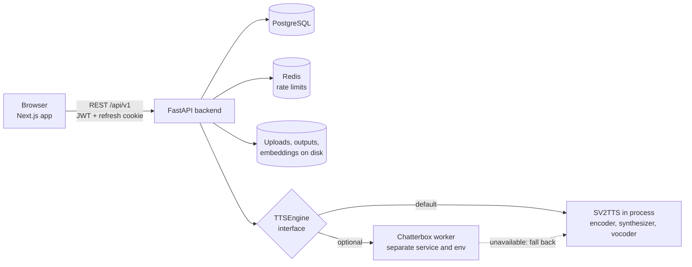
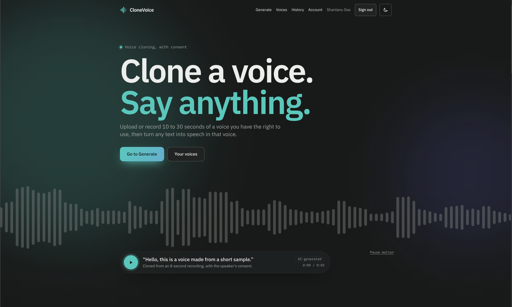
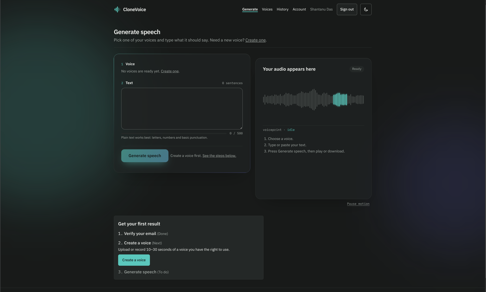
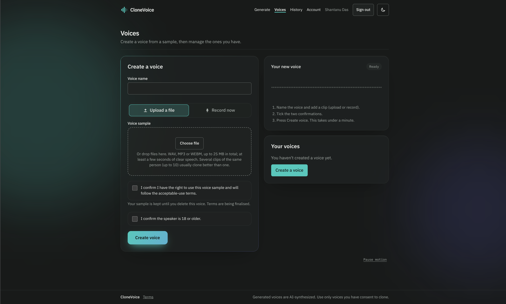
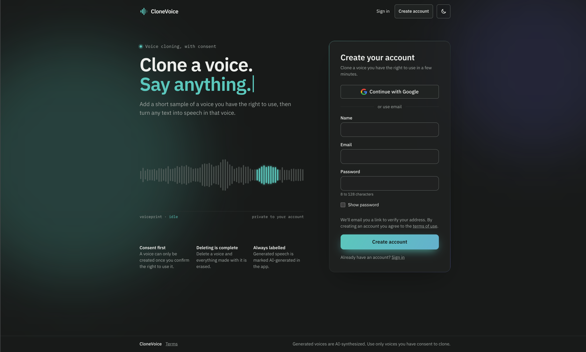

# CloneVoice


<!-- TODO: license badge. Add a LICENSE file first (none exists in the repo yet), then badge it. -->

A full-stack web application that clones a speaker's voice from short, consented recordings and speaks typed text in that voice. Voices are created without per-speaker training: a pre-trained speaker encoder turns the recordings into an embedding, and a text-to-speech engine is conditioned on it.

**Live demo:** [voice.shantanudas.dev](https://voice.shantanudas.dev) (Next.js app, FastAPI API, PostgreSQL and Redis on Railway). The home page plays a sample generated with the speaker's consent. Creating a voice needs a verified email address, and the deployment has no email provider configured yet, so new accounts cannot complete verification there.

## Overview

Voice cloning is easy to build as a notebook and hard to build as a service. This project treats it as a service problem: users sign in, upload recordings with an explicit consent attestation, get quality feedback on their recordings, generate speech, and can export or erase their data. The speech models sit behind an engine interface so a second engine can be added, and rolled back, without touching the API.

It is a solo project by one developer, built as a portfolio piece covering backend, ML inference, frontend and deployment.

## Key Features

**Voice cloning and synthesis**
- Voice profiles from one or several clips of the same speaker; the profile embedding is the mean of the clip embeddings, and each clip gets an agreement score so a mismatched clip is flagged.
- Two interchangeable speech engines behind one interface, selected by `TTS_ENGINE`: the in-process SV2TTS pipeline (default) and Chatterbox, which runs in a separate worker service. The backend falls back to the in-process engine when the worker is unavailable.
- Output quality gate with retry and best-of-N candidate selection, text normalisation and chunking, and optional emotion and intensity controls.
- Generated audio carries an inaudible AudioSeal watermark.

**Accounts and safety**
- Email and password sign-up with email verification and password reset; Google sign-in keyed on Google's stable account id rather than the email address.
- Short-lived access token (kept in memory) plus a rotating refresh token in an httpOnly cookie, with reuse detection.
- Consent attestation stored with the timestamp at upload, and an adult-speaker confirmation (`REQUIRE_ADULT_CONFIRMATION`).
- Account export (zip of the account, voices, generations and audio) and account erasure; per-generation delete.

**Operations**
- Per-route rate limits backed by Redis, a process-wide inference slot, and cgroup-aware torch thread sizing.
- Health endpoints (`/health/live`, `/health/ready`), Prometheus metrics, optional Sentry, and log redaction.
- Model checkpoints are verified against a pinned SHA256 manifest before loading; the server refuses to start with unverified weights.

## Tech Stack

| Area | Technology |
|---|---|
| Backend | Python 3.11, FastAPI, Pydantic v2, SQLAlchemy 2.0, Alembic, Authlib, PyJWT, passlib/bcrypt, SlowAPI |
| AI / ML | PyTorch, Resemblyzer (speaker encoder), vendored SV2TTS Tacotron 2 + WaveRNN, Chatterbox (worker), Librosa, AudioSeal |
| Database | PostgreSQL 15 (SQLite in tests), Redis 7 (rate limiting) |
| Frontend | Next.js 16 (App Router), React 19, TypeScript, Tailwind CSS 3, TanStack Query, Axios, react-hook-form, zod |
| Testing | pytest; Vitest, Testing Library, MSW, Playwright (e2e and visual), axe-core, Lighthouse |
| DevOps | Docker and Docker Compose, GitHub Actions (9 workflows), Railway deployment, hash-locked Python dependencies |
| Observability | Prometheus client, Sentry, structured JSON logs with correlation ids |

## Architecture



**Data flow for one voice and one generation**
1. The browser uploads one or more clips with the consent form fields. The API validates the audio, preprocesses it with Librosa (resample to 16 kHz, trim silence, normalise), computes a quality report, embeds each clip with the speaker encoder and stores the combined embedding.
2. A synthesis request names a voice profile and up to 500 characters of text. The API normalises and chunks the text, takes the process-wide inference slot, and calls the selected engine with the profile's embedding (or, for Chatterbox, its reference clip).
3. The output passes the quality gate, is watermarked, written to disk and recorded as a `generations` row; the WAV is returned and can be downloaded again from history until it expires.

**Why Chatterbox is a separate service:** it pins `torch==2.6.0` and `transformers==5.2.0`, which conflict with the application's hash-locked dependency set. A small stateless HTTP worker (`tts_worker/`) keeps the two environments apart.

## Project Structure

```
.
├── backend/                 FastAPI application
│   ├── main.py              App factory, lifespan, middleware, routers, health and metrics
│   ├── serve.py             Container entrypoint (port, volume ownership, optional weight fetch)
│   ├── api/                 Routers: auth, voice, synthesize, terms
│   ├── core/                Settings, security, database, rate limiting, metrics, log redaction
│   ├── models/              SQLAlchemy models (users, voice profiles and samples, generations, ...)
│   ├── schemas/             Pydantic request and response models
│   ├── services/            TTS engines and pipeline, audio processing and quality, email, export, erasure
│   │   └── sv2tts/          Vendored SV2TTS synthesizer and vocoder code (MIT, see THIRD_PARTY_NOTICE.md)
│   ├── alembic/             Database migrations
│   ├── tests/               pytest suite
│   ├── download_weights.py  Fetch and verify model checkpoints
│   └── weights_manifest.json  Pinned SHA256 of each checkpoint
├── tts_worker/              Separate inference service for the Chatterbox engines
├── frontend/                Next.js app (app/, components/, hooks/, lib/, tests/, e2e/, visual/)
│   └── contract/openapi.json  Generated API contract the frontend is checked against
├── scripts/ci/              Deploy and smoke-test scripts used by CI
├── .github/workflows/       CI: tests, schema drift, dependency audit, Docker builds, deploy
├── docs/screenshots/        Images used in this README
├── docker-compose.yml       db, redis, one-shot migrate, backend
└── railway.toml             Railway build and deploy configuration
```

## Getting Started

### Prerequisites

- Docker and Docker Compose
- Python 3.11 (for running tests or the API outside Docker)
- Node.js 18+ (for the frontend)

### 1. Clone and configure

```bash
git clone https://github.com/ShantanuDas15/Clone-Voice.git
cd Clone-Voice
cp backend/.env.example backend/.env
```

Edit `backend/.env`. At minimum set `JWT_SECRET_KEY` and `SESSION_SECRET_KEY` to two different random strings of 32 or more characters:

```bash
python3 -c "import secrets; print(secrets.token_urlsafe(48))"
```

For local accounts to be usable, also set `EMAIL_BACKEND=console` (prints each email, link included) or `REQUIRE_EMAIL_VERIFICATION=false`. Set `APP_ENV=development` for verbose logs. The root `.env.example` is optional and only overrides the Postgres credentials and bind address that `docker-compose.yml` uses.

### 2. Start the database and API

```bash
docker compose up --build
```

This starts PostgreSQL, Redis, a one-shot `alembic upgrade head`, and the API at http://localhost:8000 (interactive docs at http://localhost:8000/docs). The API reports `503` / `"degraded"` at `/health/ready` until model checkpoints are present.

### 3. Provision the model weights

The speaker encoder downloads on first use through `resemblyzer`. The synthesizer and vocoder checkpoints (about 424 MB together, from [huggingface.co/CorentinJ/SV2TTS](https://huggingface.co/CorentinJ/SV2TTS)) are fetched explicitly and checked against the pinned manifest:

```bash
docker compose exec backend python -m backend.download_weights --fetch --verify-inference
```

### 4. Run the frontend

```bash
cd frontend
cp .env.example .env.local
npm ci
npm run dev
```

The app is at http://localhost:3000. It expects the API at `http://localhost:8000/api/v1` and must be same-site with it so the refresh cookie is sent.

### CPU and GPU builds

The Docker image installs the **CPU-only** build of torch by default (about 1.5 GB of Python dependencies instead of about 8 GB with PyPI's CUDA wheel). For a GPU image, override the index and set `DEVICE=cuda`:

```bash
docker build -f backend/Dockerfile --build-arg TORCH_INDEX_URL=https://pypi.org/simple -t clonevoice-backend .
```

On CPU, expect synthesis to run slower than real time (see Design Decisions). The compose file does not reserve a GPU; add a `deploy.resources.reservations.devices` block to the `backend` service if you use one.

### Environment variables

The full, commented list is in [`backend/.env.example`](backend/.env.example). The ones you will most likely touch:

| Variable | Required | Default | Purpose |
|---|---|---|---|
| `DATABASE_URL` | yes | local Postgres URL | Overridden to the `db` service inside Compose |
| `JWT_SECRET_KEY` | yes | empty | Signs access and refresh tokens (32+ characters) |
| `SESSION_SECRET_KEY` | yes | empty | Signs the OAuth session cookie; must differ from the JWT key |
| `GOOGLE_CLIENT_ID`, `GOOGLE_CLIENT_SECRET`, `GOOGLE_REDIRECT_URI` | for Google sign-in | empty / local callback | OAuth credentials from Google Cloud Console |
| `REQUIRE_EMAIL_VERIFICATION` | no | `true` | Unverified accounts cannot upload or synthesize |
| `EMAIL_BACKEND`, `EMAIL_FROM`, `RESEND_API_KEY` | for real email | `disabled` | `console`, `resend` or `smtp` |
| `FRONTEND_URL` | no | `http://localhost:3000` | Redirect target after Google sign-in |
| `DEVICE` | no | `cpu` | `cpu` or `cuda` |
| `MAX_AUDIO_SIZE_MB` | no | `25` | Upload size limit |
| `TTS_ENGINE` | no | `sv2tts` | `sv2tts`, `chatterbox`, `chatterbox_turbo` or `chatterbox_nano` (the Chatterbox options need the worker) |
| `SENTRY_DSN` | no | empty | Optional error reporting |

Frontend variables (`NEXT_PUBLIC_API_BASE_URL`, `NEXT_PUBLIC_APP_ORIGIN`) are in [`frontend/.env.example`](frontend/.env.example). No real secrets are committed; `.env` files are gitignored.

## Usage

Interactive API documentation is served at `/docs` when the backend is running. An offline copy of the contract is [`frontend/contract/openapi.json`](frontend/contract/openapi.json).

Main endpoints (all under `/api/v1`):

| Area | Endpoints |
|---|---|
| Auth | `POST /auth/signup`, `/auth/login`, `/auth/refresh`, `/auth/logout`, `/auth/verify-email`, `/auth/forgot-password`, `/auth/reset-password`; `GET`, `PATCH`, `DELETE /auth/me`; `POST /auth/me/export`; `GET /auth/google` |
| Voice | `POST /voice/upload`, `GET /voice/profiles`, `POST /voice/profiles/{id}/samples`, `DELETE /voice/profiles/{id}` and `.../samples/{position}` |
| Synthesis | `POST /synthesize`, `GET /synthesize/history`, `GET /synthesize/{id}/audio`, `DELETE /synthesize/{id}`, `GET /synthesize/capabilities` |
| Health | `GET /health`, `/health/live`, `/health/ready` (outside `/api/v1`) |

Example, assuming local accounts are usable (see step 1). Export the `access_token` from the signup response as `TOKEN`. <!-- TODO: confirm the password rules and verification flow against /docs. -->

```bash
# Sign up; the response contains an access token
curl -s -X POST http://localhost:8000/api/v1/auth/signup \
  -H "Content-Type: application/json" \
  -d '{"email":"you@example.com","password":"a-long-passphrase-123","name":"You"}'

# Create a voice (consent fields are required)
curl -s -X POST http://localhost:8000/api/v1/voice/upload \
  -H "Authorization: Bearer $TOKEN" \
  -F "name=My voice" -F "consent_confirmed=true" -F "speaker_is_adult=true" \
  -F "file=@backend/tests/fixtures/sample_5sec.wav;type=audio/wav"

# Generate speech
curl -s -X POST http://localhost:8000/api/v1/synthesize \
  -H "Authorization: Bearer $TOKEN" -H "Content-Type: application/json" \
  -d '{"voice_profile_id":"<profile id>","text":"Hello, this is a test."}' \
  --output out.wav
```

The sample fixture is a synthetic tone, so it is only suitable for checking that the pipeline runs, not for judging voice quality.

## Testing

```bash
# Backend (from the repo root, with the virtualenv active)
python3.11 -m venv backend/.venv && source backend/.venv/bin/activate
pip install -r backend/requirements.txt -r backend/requirements-dev.txt
python -m pytest backend -q

# Frontend (from frontend/)
npm run typecheck && npm run lint && npm test
npm run test:e2e       # Playwright
npm run test:visual    # visual regression
```

The backend tests use SQLite and mock the speech models, so they need no weights, network or secrets (CI supplies throwaway signing keys through the environment; locally your `backend/.env` provides them). CI runs the backend suite, the frontend checks, schema-drift and dependency-audit jobs, Docker builds, and then deploys to Railway on merge to `main`. At the last full local run the backend suite reported 2193 passed and 31 skipped (the skips are tests that need real weights or private files).

## Screenshots

| Home | Generate speech |
|---|---|
|  |  |
| **Create a voice** | **Sign up** |
|  |  |

They are shown in the dark theme; the app follows the system theme and has a toggle.

These show sample data (a placeholder account and a generated tone), not a cloned voice. <!-- TODO: add a short demo GIF or video link. -->

## Design Decisions and Learnings

- **Pre-trained encoder, no per-user training.** Cloning is inference only, which keeps cost and latency predictable and makes CPU deployment possible.
- **Engine interface with fallback.** The second model could not share a Python environment with the first, so it became its own service behind the same interface, with a circuit breaker and a fallback to the in-process engine.
- **CPU inference is slow, and the docs say so.** Vocoding speed was measured on the real checkpoints: about 0.8x real time on 16 threads and 1.9x on 2 cores. PyTorch ignored the container CPU quota and used the host's core count, so the backend now reads the cgroup limit and sizes torch to it. Inference runs in a worker thread, and measured event-loop delay stayed in the low milliseconds.
- **One uvicorn worker on purpose.** The inference slot is process-local state; rate limits are shared through Redis.
- **Refuse unverified weights.** Checkpoints are checked against a pinned manifest at load time, and the server does not fall back to mock models.
- **Consent and erasure as data-model features.** Consent time is a non-null column, soft deletes protect history, and erasure removes the audio and embedding files.
- **Speech quality was measured, not assumed.** The repository includes evaluation scripts for word error rate and listening tests. <!-- TODO: add the measured WER figures here once you confirm they are the numbers you want public. -->

## Roadmap

- GPU-backed synthesis as the default path (the code supports `DEVICE=cuda`; it is not the tested default).
- Object storage (S3 or Cloudflare R2) in place of the local filesystem.
- A working email provider on the live deployment.
- Real-time streaming synthesis.

<!-- TODO: trim or extend this list to match your actual plans. -->

## Contributing

This is a personal portfolio project and is not currently seeking contributions. Issues and suggestions are welcome.

## License

<!-- TODO: no LICENSE file exists in the repository. Add one (for example MIT) and state it here. -->

The vendored SV2TTS code in `backend/services/sv2tts/` is MIT licensed; see its `THIRD_PARTY_NOTICE.md`.

## Author

<!-- TODO: fill in. -->
- Name: `<your name>`
- GitHub: [ShantanuDas15](https://github.com/ShantanuDas15)
- LinkedIn: `<your LinkedIn URL>`
- Email: `<your email>`
